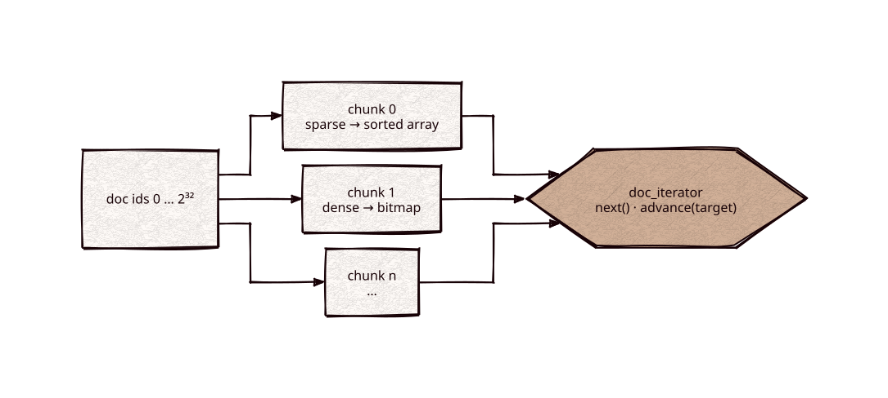

# docset

Part of [Kronuz C++ Libraries](https://github.com/Kronuz/cpp-libraries), a collection of small, reusable C++ libraries.

[](https://github.com/Kronuz/docset/actions/workflows/ci.yml)
[](LICENSE)


Sets of document ordinals for C++20: a dense bitset, a sorted array, and a chunked
set that keeps each region of the id space in its cheaper form. Header-only, no
dependencies. It also defines `doc_iterator`, the iteration contract a search
engine's posting lists, scorers, and filters share.



## ✨ Highlights

One header, `docset.hh`:

- `docset::bitset`: one bit per ordinal. Live-docs masks and dense filters.
- `docset::sorted_set`: strictly increasing 32-bit ordinals, with SIMD intersection
  and galloping search.
- `docset::set`: the id space split into 64Ki chunks; a chunk holds a sorted array
  of 16-bit low halves, or an 8 KiB bitmap once it has more than 4096 members (the
  Roaring layout, without run containers). AND, OR, and ANDNOT return new sets,
  `count()` is cached, and every shape has a SIMD path.
- `doc_iterator`: `doc()`, `next()`, `advance(target)`, `cost()`, ending at
  `docset::no_more_docs`. All three set types provide one.

## 📦 Installation

Requires a C++20 compiler; CMake 3.14 or newer for the CMake route. CI builds it on
Linux (x86_64, arm64), macOS (arm64, x86_64), and FreeBSD, plus ASan, UBSan, and TSan
builds.

```cmake
include(FetchContent)
FetchContent_Declare(docset
  GIT_REPOSITORY https://github.com/Kronuz/docset.git
  GIT_TAG        main)
FetchContent_MakeAvailable(docset)

target_link_libraries(my_app PRIVATE docset::docset)
```

## 🚀 Quick start

```cpp
#include "docset.hh"

auto a = docset::set::from_sorted(universe, {3, 70000, 70001, 5000000});
auto b = docset::set::from_sorted(universe, {70001, 5000000});

docset::set both = a & b;           // {70001, 5000000}
docset::set either = a | b;
docset::set only_a = a - b;
std::uint64_t n = both.count();     // cached, O(1)

auto it = a.begin_iteration();
for (auto d = it.advance(60000); d != docset::no_more_docs; d = it.next()) {
    // 70000, 70001, 5000000
}
```

## ⚡ Performance

`docset::set` against CRoaring 5.4.0 (`db0d1e9`) on the same members: random sets per
density over 2^24 ordinals, each operation producing a new set. Each timed operation
takes the next of several random input pairs (eight below density 0.07, two above), so a
branch predictor cannot memorize one input. Trials alternate between the two libraries,
and the ratio is the median of per-trial ratios (below 1 means docset is faster). Apple
clang 17 with `-O3 -DNDEBUG -std=gnu++20` (CRoaring with `-O3 -DNDEBUG`), on a machine
kept idle for the run. Each cell is the mean of the runs named under the machine; runs agree
within 0.06.

Apple M4 Pro (arm64), mean of two runs:

| Density | AND | OR | ANDNOT | Iterate | Count |
|---:|---:|---:|---:|---:|---:|
| 1e-6 | 0.89 | 0.67 | 0.70 | 0.55 | 0.82 |
| 1e-5 | 0.23 | 0.73 | 0.73 | 0.41 | 0.29 |
| 1e-4 | 0.29 | 0.70 | 0.59 | 0.60 | 0.15 |
| 1e-3 | 0.30 | 0.50 | 0.28 | 0.20 | 0.14 |
| 1e-2 | 0.29 | 0.35 | 0.29 | 0.09 | 0.14 |
| 0.1 | 0.45 | 0.67 | 0.70 | 0.87 | 0.14 |
| 0.5 | 0.63 | 0.70 | 0.71 | 0.81 | 0.14 |

Intel Core i9-9980HK (x86-64, macOS 15), mean of three runs:

| Density | AND | OR | ANDNOT | Iterate | Count |
|---:|---:|---:|---:|---:|---:|
| 1e-6 | 0.98 | 0.60 | 0.65 | 0.56 | 0.71 |
| 1e-5 | 0.28 | 0.65 | 0.67 | 0.32 | 0.27 |
| 1e-4 | 0.37 | 0.68 | 0.72 | 0.22 | 0.15 |
| 1e-3 | 0.57 | 0.82 | 0.86 | 0.17 | 0.15 |
| 1e-2 | 0.96 | 1.03 | 1.25 | 0.18 | 0.15 |
| 0.1 | 0.50 | 0.85 | 0.85 | 0.72 | 0.15 |
| 0.5 | 0.75 | 0.84 | 0.87 | 0.61 | 0.15 |

docset is faster in every cell on the M4. On the i9 it is faster in every cell but OR and
ANDNOT at density 1e-2 (arrays of about 650 members per chunk), where CRoaring is 3% and
20% faster. On x86-64 CPUs with AVX-512, CRoaring also has AVX-512 array kernels that
docset does not.

Reproduce with:

```sh
cmake -S . -B build -DCMAKE_BUILD_TYPE=Release -DDOCSET_BENCH_REFERENCE=ON
cmake --build build --target docset_bench && build/docset_bench
```

`DOCSET_BENCH_REFERENCE` fetches CRoaring at `db0d1e9` and builds it for the benchmark
only; the library never links it. `-DFETCHCONTENT_SOURCE_DIR_CROARING=<checkout>` uses a
local checkout instead.

Two code paths depend on the CPU. A bitmap AND or ANDNOT whose result has at most 4096
members converts to an array (an AND of two density-0.1 sets produces about 650 members
per chunk). Up to 96 members on x86-64 and 32 on arm64 the conversion is a plain loop
over the set bits; above that it takes two or four bits per word without a branch, chosen
by the result size, and on x86-64 uses BMI1 when the CPU has it. The array kernels are
compiled for SSE4.2 or NEON. See [ARCHITECTURE.md](ARCHITECTURE.md).

### Bitmap-to-array extraction

`build/docset_micro_extract [ROUNDS [DENSITIES]]` times the conversion above against the
variants it is chosen from: the plain loop (one iteration per set bit), two or four bits per
word without a branch, a byte table, and on x86-64 the BMI1 forms. Each timed pass cycles
through 256 different bitmaps, so a branch predictor cannot memorize the data, and every
variant is checked for identical output first. Median nanoseconds per 64Ki-bit bitmap over
15 rounds, mean of two runs, Apple clang 17 `-O3 -DNDEBUG`; `landed` is
`docset::detail::extract_bits`, the routine the set operations call:

Apple M4 Pro (arm64), the runs agree within 5%:

| Members | landed | loop | two bits | four bits |
|---:|---:|---:|---:|---:|
| 13 | 391 | 407 | 560 | 1076 |
| 33 | 516 | 516 | 556 | 1070 |
| 131 | 568 | 980 | 564 | 1070 |
| 655 | 770 | 3516 | 768 | 1082 |
| 1311 | 1166 | 4552 | 1717 | 1171 |
| 2621 | 2229 | 6068 | 6686 | 2230 |
| 3932 | 5565 | 6972 | 9158 | 5558 |

Intel Core i9-9980HK (x86-64, macOS 15), the runs agree within 10%:

| Members | landed | loop | BMI1 loop | BMI1 two bits | BMI1 four bits |
|---:|---:|---:|---:|---:|---:|
| 13 | 394 | 392 | 414 | 1472 | 2502 |
| 33 | 590 | 572 | 569 | 1456 | 2532 |
| 131 | 1452 | 1488 | 1469 | 1456 | 2506 |
| 655 | 1644 | 4634 | 4642 | 1674 | 2586 |
| 1311 | 2614 | 5905 | 5932 | 2681 | 2652 |
| 2621 | 3691 | 7490 | 7228 | 7046 | 3728 |
| 3932 | 6720 | 8587 | 7928 | 8588 | 6764 |

`landed` is the fastest form or within 5% of it in every row. The branch-free forms cost the
same for any result (1450 ns on the i9, 560 on the M4 for two bits per word), while the
loop costs 5 to 9 ns per member below 200 members, so the loop wins below about 130
members on the i9 and 40 on the M4 under Apple clang; `landed` takes it up to 96 and 32.
Other compilers move the crossover: gcc 16 on the i9 99 members (its loop is 2.5x slower on
an empty bitmap), gcc 16 and LLVM 23 on the M4 43, LLVM 23 on the i9 135. On a shared
AMD EPYC 7763 VM under gcc 11 the loop wins up to about 195 members (131 members: 1520 ns
against 1960), so results of 97 to 195 members take a branch-free form that is slower there
by up to 45%. The limits are the lowest crossover rounded down to a multiple of 16. With
gcc 16 on the i9 and gcc 11 on the EPYC the BMI1 branch-free forms lead from about 650
members up, as under Apple clang.

## 🛠️ Building and testing

```sh
cmake -S . -B build && cmake --build build && ctest --test-dir build
build/docset_cmp_bench   # AND, ANDNOT, and test() against the reference test/docset_old.hh
build/docset_ab_new      # the same rows and more, one docset version per binary:
python3 bench/ab_compare.py build/docset_ab_old build/docset_ab_new
build/docset_micro_extract   # bitmap-to-array extraction variants, ns per bitmap by density
```

The tests compare every operation with `std::set_*` across densities, universes
that cross chunk boundaries, and mixed array/bitmap chunks; check iterators with
interleaved `next()` and `advance()`; and drive the 16-bit SIMD kernels directly
with heavy overlap at every small size and at both ends of the 16-bit range;
and freeze chunks of 1 to 65536 members in the first, second and last chunk, checking
the container kind at 4096, 4097, 65535 and 65536 and rank and membership at every
ordinal. `docset_portable_test` builds with `DOCSET_NO_SIMD`. `test/diff.cc` checks every
operation against the reference implementation in `test/docset_old.hh`, including results
of exactly 0, 4094 to 4098 and 65536 members (an empty result leaves no chunk);
`docset_diff_portable` runs it with `DOCSET_NO_SIMD`.
`docset_codegen` compiles the point-test lower bound to assembly and looks for a
conditional move.

## 🎯 When to use it

- ✅ Posting lists, filters, and deleted-document sets over 32-bit ids.
- ❌ Long runs of consecutive ids: there are no run-length containers yet.

### Limits

- No run-length containers: long consecutive ranges cost a bitmap per chunk.
- The vector union uses SSE4.1 on x86-64 and NEON on AArch64; other targets use the
  scalar merge.

## 📚 Documentation

- [ARCHITECTURE.md](ARCHITECTURE.md): the design and the format.
- [CHANGELOG.md](CHANGELOG.md): changes by date.
- [AGENTS.md](AGENTS.md): repository map and invariants.

## 🤝 Contributing

Issues and pull requests are welcome. Read [AGENTS.md](AGENTS.md) first. CI must
pass on every platform.

## 📄 License

MIT, Copyright (c) 2026 Germán Méndez Bravo. See [LICENSE](LICENSE).
