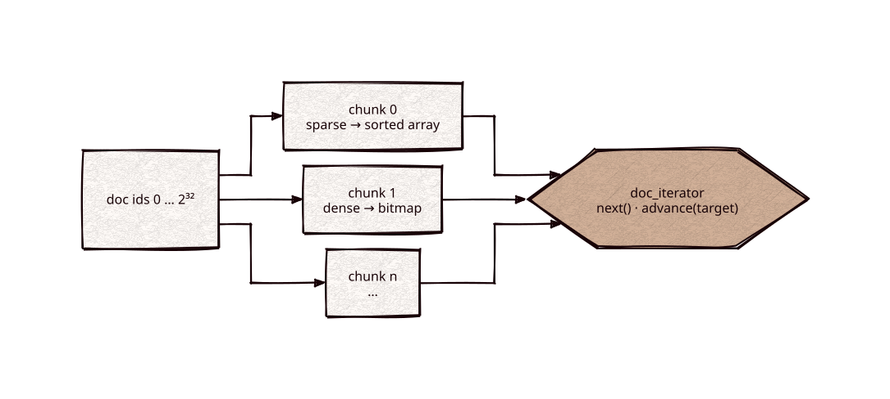

# docset

[](https://github.com/Kronuz/docset/actions/workflows/ci.yml)
[](LICENSE)


Sets of document ordinals for C++20: a dense bitset, a sorted array, and a chunked
set that keeps each region of the id space in its cheaper form. Header-only, no
dependencies. It also defines `doc_iterator`, the iteration contract a search
engine's posting lists, scorers, and filters share.



## ✨ Highlights

One header, `docset.hh`:

- `docset::bitset`: one bit per ordinal. Live-docs masks and dense filters.
- `docset::sorted_set`: strictly increasing 32-bit ordinals, with SIMD intersection
  and galloping search.
- `docset::set`: the id space split into 64Ki chunks; a chunk holds a sorted array
  of 16-bit low halves, or an 8 KiB bitmap once it has more than 4096 members (the
  Roaring layout, without run containers). AND, OR, and ANDNOT return new sets,
  `count()` is cached, and every shape has a SIMD path.
- `doc_iterator`: `doc()`, `next()`, `advance(target)`, `cost()`, ending at
  `docset::no_more_docs`. All three set types provide one.

## 📦 Installation

Requires a C++20 compiler; CMake 3.14 or newer for the CMake route. CI builds it on
Linux (x86_64, arm64), macOS (arm64, x86_64), and FreeBSD, plus ASan, UBSan, and TSan
builds.

```cmake
include(FetchContent)
FetchContent_Declare(docset
  GIT_REPOSITORY https://github.com/Kronuz/docset.git
  GIT_TAG        main)
FetchContent_MakeAvailable(docset)

target_link_libraries(my_app PRIVATE docset::docset)
```

## 🚀 Quick start

```cpp
#include "docset.hh"

auto a = docset::set::from_sorted(universe, {3, 70000, 70001, 5000000});
auto b = docset::set::from_sorted(universe, {70001, 5000000});

docset::set both = a & b;           // {70001, 5000000}
docset::set either = a | b;
docset::set only_a = a - b;
std::uint64_t n = both.count();     // cached, O(1)

auto it = a.begin_iteration();
for (auto d = it.advance(60000); d != docset::no_more_docs; d = it.next()) {
    // 70000, 70001, 5000000
}
```

## ⚡ Performance

`docset::set` against CRoaring on the same members: two random sets per density
over 2^24 ordinals, each operation producing a new set. Trials alternate between
the two libraries, and the ratio is the median of per-trial ratios (below 1 means
docset is faster). Intel i9-9980HK, macOS, Apple clang `-O3`.

| Density | AND | OR | ANDNOT | Iterate | Count |
|---:|---:|---:|---:|---:|---:|
| 1e-6 | 0.72 | 0.61 | 0.64 | 0.55 | 0.71 |
| 1e-5 | 0.20 | 0.63 | 0.66 | 0.30 | 0.26 |
| 1e-4 | 0.29 | 0.77 | 0.77 | 0.22 | 0.15 |
| 1e-3 | 0.62 | 0.96 | 0.92 | 0.18 | 0.15 |
| 1e-2 | 0.98 | 1.08 | 1.14 | 0.18 | 0.15 |
| 0.1 | 1.03 | 0.89 | 0.87 | 0.72 | 0.15 |
| 0.5 | 0.77 | 0.85 | 0.93 | 0.62 | 0.15 |

On the Linux gate VM (Clang 18; the host shared with another VM), the worst rows are
at density 0.01: OR 1.15 and ANDNOT 1.07–1.17; every other row is below 1.

Reproduce with:

```sh
cmake -S . -B build -DCMAKE_BUILD_TYPE=Release -DDOCSET_BENCH_REFERENCE=ON
cmake --build build && build/docset_bench
```

`DOCSET_BENCH_REFERENCE` fetches CRoaring for the benchmark only; the library never
links it.

## 🛠️ Building and testing

```sh
cmake -S . -B build && cmake --build build && ctest --test-dir build
```

The tests compare every operation with `std::set_*` across densities, universes
that cross chunk boundaries, and mixed array/bitmap chunks; check iterators with
interleaved `next()` and `advance()`; and drive the 16-bit SIMD kernels directly
with heavy overlap at every small size. `docset_portable_test` builds with
`DOCSET_NO_SIMD`.

## 🎯 When to use it

- ✅ Posting lists, filters, and deleted-document sets over 32-bit ids.
- ❌ Long runs of consecutive ids: there are no run-length containers yet.

### Limits

- No run-length containers: long consecutive ranges cost a bitmap per chunk.
- The SIMD union is x86-only (SSE4.1); AArch64 uses NEON for intersection and
  difference and the scalar merge for union.

## 📚 Documentation

- [ARCHITECTURE.md](ARCHITECTURE.md): the design and the format.
- [AGENTS.md](AGENTS.md): repository map and invariants.

## 🤝 Contributing

Issues and pull requests are welcome. Read [AGENTS.md](AGENTS.md) first. CI must
pass on every platform.

## 📄 License

MIT, Copyright (c) 2026 Germán Méndez Bravo. See [LICENSE](LICENSE).
